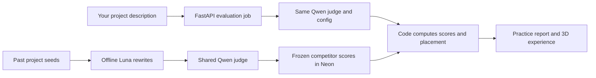

# LennyRoasts

### Pitch your hack. Meet the competition. Get roasted by Lenny.

**Hackathon practice feedback, built for Knight Hacks IX at UCF.**

LennyRoasts turns your project description into a practice judging session. Explore a 3D campus, pitch to Lenny in a sponsor classroom, and see how your project compares with a frozen field of simulated competitors. Each report explains your scores, shows rival projects, and gives you concrete next steps before the real demo.

[Quick start](#quick-start) · [How it works](#how-it-works) · [Challenge tracks](#challenge-tracks) · [Team docs](#team-docs)

## The experience

- **Bring your idea.** Write a description or import PDF/Markdown notes, review the extracted text, and choose optional sponsor tracks. File extraction happens in your browser.
- **Explore UCF in 3D.** Move through the Engineering buildings, atrium, sponsor classrooms, and Cape Ballroom, with modeled Lenny hosts and animated competitor avatars.
- **Get category-specific feedback.** See scores out of 10, criterion breakdowns, eligibility, placement ranges, evidence quotes, and suggestions for improvement.
- **Meet the field leaders.** Compare your pitch with up to three returned rivals per category in the atrium's report panels.
- **Watch practice ceremonies.** Visit the ballroom for simulated award presentations using the report's returned leaders and scores.
- **Keep your session.** Pause and resume polling, return after a reload, and retain your idea while moving between scenes. Live reports are private to the requesting session and expire after one hour.

> Placements describe a simulated practice field. Feedback evaluates your write-up; it does not verify working software or predict real hackathon winners.

## How it works



Competitors are prepared once with Luna through Codex, then scored offline with **Qwen3-32B via Hugging Face / DeepInfra**. Live submissions use that same shared scorer and frozen configuration. A request scores only your project; it reuses the saved competitor scores.

Each category receives **three validated scoring runs**. Code computes averages, eligibility, and placement, including ties and variation across runs. Best Overall uses four criteria for **/20**; other categories add relevance for **/25**. Both are normalized to **/10**. Categories with relevance require a score of at least 3 in two of the three runs to qualify for placement.

Model, provider, prompts, rubric, schema, and settings are versioned together. Changing the judge requires a new version and a full field rescore.

## Challenge tracks

Four sponsor tracks are optional. Four general categories are evaluated automatically.

| Track | Selection | Eligible competitors in the v6 field |
| --- | --- | ---: |
| Best Use of Gemini API | Optional | 47 |
| Best Use of ElevenLabs | Optional | 41 |
| Best Use of Databricks | Optional | 20 |
| BNY Financial Services | Optional | 32 |
| Best Overall Hack | Automatic | 106 |
| Best AI Hack | Automatic | 95 |
| Best Game Hack | Automatic | 14 |
| Most “Useful” Hack | Automatic | 13 |

Most “Useful” is the **funny/goofy** category. Visual and hardware tracks are outside this text-based MVP; Neon is used for storage and is not a sponsor track.

The live practice artifact contains **106 accepted projects**: Luna rewrites of real historical seeds, scored with judge `kh9-qwen32b-v6` in pool `kh9-smoke-n106`. Category counts differ because of sponsor opt-ins and eligibility. An eligible user's placement is out of the eligible competitor count **plus one**.

Local development also includes a separate **200-project synthetic mock field** with deterministic heuristic scores. Mock results are labeled and never substitute for live Qwen results.

## Quick start

Use **Python 3.13+** and **Node.js 24**. Run the following from the repository root in two terminals. Mock mode needs no inference or database credentials.

**1. Start the backend**

```sh
python3 -m venv .venv
.venv/bin/python -m pip install -r backend/requirements.txt -r offline/requirements.txt
LENNY_MODE=mock .venv/bin/python -m uvicorn backend.app.main:app \
  --host 127.0.0.1 --port 8110 --reload
```

**2. Start the frontend**

```sh
cd frontend
npm ci
npm run dev
```

Open [http://127.0.0.1:5173](http://127.0.0.1:5173), choose **Load sample**, and submit a practice pitch. After completion, explore the atrium report and the award ceremonies. The Vite development server proxies `/api` to the backend on port `8110`.

See the [backend guide](backend/README.md) and [frontend guide](frontend/README.md) for mode details and Windows setup.

### Live mode

Live mode needs server-side `HF_TOKEN`, `DATABASE_URL`, and `DATABASE_URL_DIRECT`. Copy the empty [.env.example](.env.example) to an ignored `.env.local` and fill in your own values. Follow the [migration and validated import instructions](backend/README.md#neon-migrations-and-validated-import) to activate the existing scored artifact:

```text
offline/data/kh9-smoke/kh9-smoke-n106__kh9-qwen32b-v6.json
```

Then start one backend instance:

```sh
LENNY_MODE=live .venv/bin/python -m uvicorn backend.app.main:app \
  --host 127.0.0.1 --port 8110 --workers 1 --no-access-log
```

Live scoring uses paid provider calls. Keep credentials on the server and the frontend/API on the same origin. Readiness requires a complete active field and configured services; incomplete scoring produces an error without a fabricated report.

## Stack and API

| Layer | Technology |
| --- | --- |
| Interface | React, TypeScript, Vite, Three.js |
| Document import | Browser-side Markdown extraction and PDF.js |
| API and jobs | Python, FastAPI, bounded background worker |
| Shared judge | Qwen3-32B via Hugging Face / DeepInfra |
| Persistence | Neon PostgreSQL, SQLAlchemy, psycopg |
| Offline preparation | Luna through Codex, Python validation and export tools |
| API types | OpenAPI-generated TypeScript |

The frontend uses three endpoints and never calls the model provider directly:

| Method | Endpoint | Purpose |
| --- | --- | --- |
| `GET` | `/api/challenges` | Challenge definitions, frozen versions, and field readiness |
| `POST` | `/api/evaluations` | Submit a project; receive a `202` queued job |
| `GET` | `/api/evaluations/{evaluation_id}` | Poll until completion or failure |

The API accepts the shared Devpost-style submission schema; the UI adapts your idea description to it. Live jobs capture their judge/pool versions and persist in Neon. Reports include criteria, three runs, rationale, validated evidence, warnings, placement, rivals, and improvements. See the [contract guide](contracts/README.md), [OpenAPI schema](contracts/openapi.json), and [synthetic examples](contracts/fixtures.json).

## Development checks

From the repository root:

```sh
.venv/bin/python -m backend.tools.check_contracts
.venv/bin/python -m pytest backend/tests offline/tests -q
```

From `frontend/`:

```sh
npm run contracts
npm test
npm run build
```

Generated types should remain in sync with the contract. Do not hand-edit `frontend/src/api/contract.d.ts`.

## Project status

The repository includes the offline field pipeline, shared judge, Neon imports and private jobs, and the 3D frontend. The [October 11 integration record](docs/DEV2_STATUS.md) documents activation of the 106-project field, real Qwen API and browser evaluations, ranking checks, session isolation, and report persistence across a backend restart. The [frontend guide](frontend/README.md) records later scene and ceremony checks using synthetic fixtures.

Production hosting and deployment are not verified. The frozen judge can misjudge category fit, and placement ranges can be wide. Human-judge agreement, winner backtesting, fine-tuning, and a live leaderboard remain outside the MVP.

## Team docs

| Area | Owner | Guide |
| --- | --- | --- |
| `offline/`, `experiments/` | Person 1 — collection, Luna preparation, field scoring/export | [Offline pipeline](offline/README.md) |
| `backend/`, `contracts/`, `docs/`, shared root files | Person 2 — API, shared judge, Neon, integration | [Backend guide](backend/README.md) |
| `frontend/` | Person 3 — interface, API integration, demo flow | [Frontend guide](frontend/README.md) |

Start with the [team handoff](docs/TEAM_HANDOFF.md), [project plan](plan_draft.md), and [agent ownership rules](AGENTS.md). Full continuation prompts are available for [Dev1](docs/prompts/DEV1_OFFLINE.md), [Dev2](docs/prompts/DEV2_BACKEND.md), and [Dev3](docs/prompts/DEV3_FRONTEND.md).

Use separate worktrees and `codex/offline-*`, `codex/backend-*`, or `codex/frontend-*` branches. Keep changes within your owned paths; Person 2 coordinates shared changes and serial integration merges. The existing scored artifact is the agreed handoff—reuse it rather than duplicating or rescoring the field. Keep credentials, new runtime inputs/reports, and raw provider responses out of Git; use ignored `.local-tests/` for local evidence.
